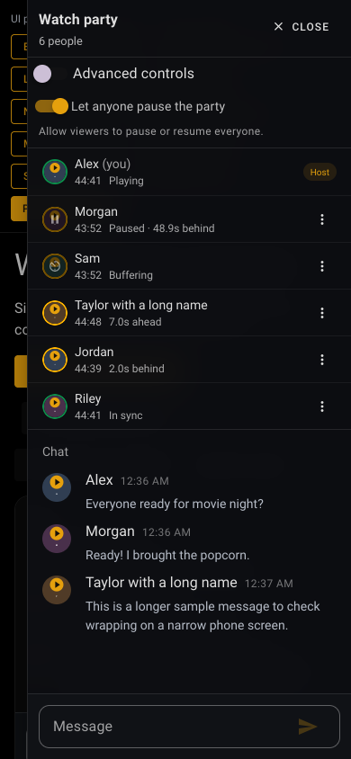

# Sync regression harness

Run `npm run test:sync-fuzz` to replay seek-landing incidents and seeded decoder faults. These tests also run in the regular frontend CI suite. No Plex connection or live room is required.

`test/fixtures/seek-landing-incidents.json` contains anonymized playback positions from the reported forward-jump incident and the ahead-of-host status example. The harness exercises application seek actions, the player adapter, event waits, and periodic sync decisions against a deterministic decoder double. It verifies one bounded source reload after a bad landing, suppression of repeated failed corrections, paused playback, combined bad landings and missing events, bounded recovery deadlines, naturally advancing playback, and cancellation/ownership across source or manual-seek changes. Status tests verify ahead/behind labels and avatar tolerance consistently.

The default run uses 12 fixed seeds with 30 fault cases each, plus 1,000 generated participant timelines and 10,000 landing-window cases. Expand the fault run or reproduce a failure with its reported seed:

```sh
SYNC_FUZZ_CASES=200 npm run test:sync-fuzz
SYNC_FUZZ_SEED=20261019 SYNC_FUZZ_CASES=200 npm run test:sync-fuzz
```

Failures include the seed, step, and fault number. This is synthetic decoder coverage; it does not establish how an actual Plex stream or browser codec will seek. Live playback verification remains a separate step.

The development UI preview includes sample viewers seven seconds ahead and two seconds behind. Both use signed labels without enabling advanced controls:


